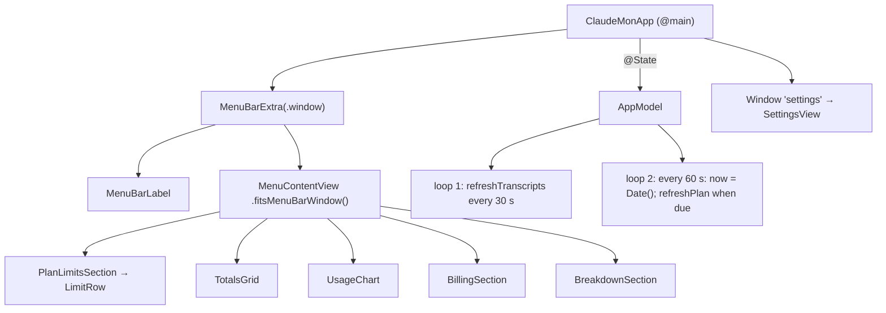

# ARCH.4 — App and UI

Implements R-CMUI-001 to R-CMUI-013, plus R-CMLIM-009 to R-CMLIM-011 and R-CMRPT-009 to R-CMRPT-011 (presentation). Features through it: [F-1](../features/lim/f-001-plan-limits.md), [F-2](../features/lim/f-002-menu-bar-readout.md), [F-5](../features/use/f-005-usage-charts.md), [F-9](../features/app/f-009-menu-bar-app.md), [F-10](../features/app/f-010-settings.md), [F-11](../features/app/f-011-launch-at-login.md), [F-13](../features/app/f-013-app-icon.md).

## Architecture Overview

- `AppModel` is `@MainActor @Observable`. Views read it directly, and settings write through `@Bindable`.
- `now` ticks every 60 seconds, so "resets in…" and the day boundary stay current without per-view timers.
- `WindowFitter` (COR-1) sizes the panel's `NSWindow` to its content and keeps the top edge fixed.
- `Snapshot` (`ClaudeMon --snapshot <dir>`) renders the panel to PNGs in light and dark, for layout checks. It never touches the Keychain. AppKit-backed controls render as placeholders in `ImageRenderer`.
- The app icon is a build artifact (`Resources/AppIcon.icns`), drawn by `scripts/make-icon.swift`.

## Key Symbols

| Symbol | File | Role |
|---|---|---|
| `AppModel` | `Sources/ClaudeMon/AppModel.swift` | State, settings, refresh loops, derived reports, launch at login |
| `MenuContentView` and sections | `Sources/ClaudeMon/MenuContentView.swift` | The panel |
| `UsageChart`, `ChartMetric` | `Sources/ClaudeMon/UsageChart.swift` | Stacked bars, hover tooltip |
| `Theme`, `Format` | `Sources/ClaudeMon/Theme.swift` | Palette, status colours, number and time formatting |
| `WindowFitter`, `WindowReader` | `Sources/ClaudeMon/WindowFitter.swift` | Panel height and anchoring |
| `SettingsView` | `Sources/ClaudeMon/SettingsView.swift` | Settings form |
| `drawIcon(in:size:)` | `scripts/make-icon.swift` | Icon artwork |

## API Reference

`AppModel` (internal to the app target):

| Member | Purpose |
|---|---|
| `entries`, `planStatus`, `planError`, `lastScan`, `isScanning`, `now` | Observed state |
| `billingDay`, `weekStart`, `planPriceOverride`, `fetchPlanLimits`, `planRefreshMinutes`, `menuBarStyle` | Settings, saved on set |
| `refreshAll()`, `refreshTranscripts(full:)`, `refreshPlan()`, `reloadPrices()` | Actions |
| `report(_:)`, `billing`, `effectivePlanPrice`, `menuBarText`, `sessionLimit`, `weeklyLimit` | Derived |
| `launchAtLogin` | `SMAppService.mainApp` status and register / unregister |

## Debugging

- **Layout:** `ClaudeMon --snapshot /tmp/snap` writes `today|week|billing-light|dark.png` and exits.
- **Real window geometry:** System Events can click `menu bar item 1 of menu bar 2` of process ClaudeMon, click radio buttons in `radio group 1 of group 1 of window 1`, and read `position` / `size`. COR-1 was verified this way.
- **The panel drifts after a tab switch:** check that `.fitsMenuBarWindow()` is still on `MenuContentView`'s root.

## Revision history

| Version | Date | Change |
|---|---|---|
| 1.3.0 | 2026-10-15 | v1.2.0 (736d417): icon radius revision (R-CMUI-013) |
| 1.2.0 | 2026-10-15 | v1.1.0 (1618231): app icon (R-CMUI-011, -012) |
| 1.1.0 | 2026-10-15 | v1.0.1 (4a42147): WindowFitter (R-CMUI-008) |
| 1.0.0 | 2026-10-15 | v1.0.0 (29d0828): initial page |
