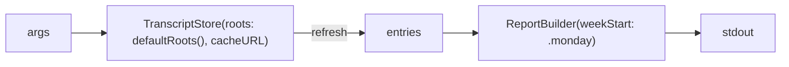

# ARCH.5 — Terminal report

Implements R-CMCLI-001 to R-CMCLI-003 (`spec/app/cli/`). Feature through it: [F-12](../features/app/f-012-terminal-report.md).

## Architecture Overview

`Sources/claudemon-report/main.swift` is a top-level-code executable. It parses its arguments by hand (three flags), builds a `TranscriptStore` over the app's cache (or over a temporary file with `--no-cache`), and prints each `ReportPeriod` and the `BillingComparison`. Its week is always the Monday calendar week, because it fetches no plan limits.



## Key Symbols

| Symbol | File | Role |
|---|---|---|
| top-level code | `Sources/claudemon-report/main.swift` | Arguments, store, printing |
| `tok(_:)`, `usd(_:)` | same | Number formatting |

## API Reference

```text
claudemon-report [--billing-day N] [--plan-price USD] [--no-cache]
  exit 0 on success, 2 on unknown arguments
```

## Debugging

Run it with `--no-cache` to recount from transcripts alone and compare with the app's figures.

## Revision history

| Version | Date | Change |
|---|---|---|
| 1.0.0 | 2026-10-15 | v1.0.0 (29d0828): initial page |
