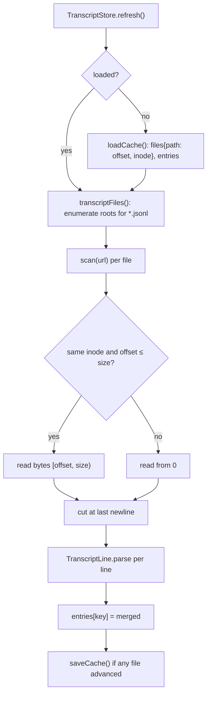

# ARCH.1 — Transcript accounting (core)

Implements R-CMUSE-001 to R-CMUSE-010 (`spec/app/use/`). Features through it: [F-3](../features/use/f-003-token-accounting.md), and indirectly F-4 to F-8 and F-12, which consume its entries.

## Architecture Overview



`TranscriptStore` is an `actor`, so the app's 30-second loop and an on-open refresh never scan at the same time. `TranscriptLine.parse` filters cheaply first: a line without the bytes `"usage"` is skipped before JSON decoding. That keeps a cold scan of 529 MB at 3.9 s.

## Key Symbols

| Symbol | File | Role |
|---|---|---|
| `UsageEntry` | `Sources/ClaudeMonCore/UsageEntry.swift` | One billed call. `key` = `message.id|requestId`; token fields; `merged(with:)` |
| `TranscriptLine.parse(_:fallbackProject:)` | same | Decodes the minimal `Line` / `Message` / `Usage` structs; skips `<synthetic>` |
| `TranscriptStore` | `Sources/ClaudeMonCore/TranscriptStore.swift` | Incremental scanner plus persistent cache |
| `TranscriptStore.defaultRoots()` | same | `$CLAUDE_CONFIG_DIR` (comma-separated) or `~/.claude` and `~/.config/claude`, each plus `projects` |

## API Reference

```swift
public actor TranscriptStore {
    public init(roots: [URL], cacheURL: URL)
    public static func defaultRoots() -> [URL]
    public func refresh() -> [UsageEntry]      // scan new bytes, return all known entries
    public func rescanAll() -> [UsageEntry]    // forget offsets, re-read every file, keep history
}
public struct UsageEntry: Codable, Hashable, Sendable {
    public var key, model, project, sessionId: String; public var timestamp: Date
    public var inputTokens, outputTokens, cacheWrite5mTokens, cacheWrite1hTokens, cacheReadTokens, webSearches: Int
    public var fast: Bool
    public var totalTokens: Int { get }; public var promptTokens: Int { get }
    public func merged(with other: UsageEntry) -> UsageEntry
}
```

## Debugging

- **Tests:** `xcrun swift test --filter "ParsingTests|StoreTests"`.
- **Counts look low:** check `CLAUDE_CONFIG_DIR`. If it's set, only those roots are scanned.
- **Counts doubled after an upgrade:** the cache `version` didn't match, so everything was re-read. Duplicates still merge by key, so totals stay correct.
- **Start over:** Settings › Rescan transcripts (history from deleted transcripts is kept), or delete `usage-cache.json` (history is lost).
- **Cross-check:** `claudemon-report --no-cache` scans into a temporary cache and prints the totals.

## Revision history

| Version | Date | Change |
|---|---|---|
| 1.0.0 | 2026-10-15 | v1.0.0 (29d0828): initial page |
