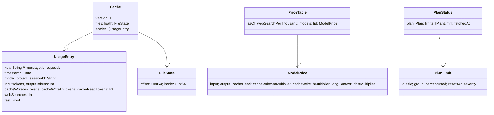

# ARCH.6 — Data model

The files the app owns are specified as formats in the specification: FMT.1 is `pricing.json` and FMT.2 is `usage-cache.json`. This page shows how the types relate.

## Architecture Overview

## Key Symbols

| Store | Type | Written by | Read by |
|---|---|---|---|
| `usage-cache.json` (FMT.2) | `TranscriptStore.Cache` | `TranscriptStore.saveCache()` | `TranscriptStore.loadCache()` (app and CLI) |
| `pricing.json` (FMT.1) | `PriceTable` | `PriceTable.loadOrInstall(at:)`, defaults on first run; then the owner | the same |
| `UserDefaults` | scalars | `AppModel` `didSet` | `AppModel.init` |
| Memory only | `PlanStatus` | `PlanUsageClient.fetch()` | views |

## API Reference

Dates in the cache are encoded as seconds since 1970 (`JSONEncoder.cache`, `JSONDecoder.cache`). Cache `version` 1. A mismatched version is ignored and the cache rebuilt from the transcripts on disk.

## Debugging

`python3 -c "import json;d=json.load(open('…/usage-cache.json'));print(len(d['entries']))"` counts the cached calls.

## Revision history

| Version | Date | Change |
|---|---|---|
| 1.0.0 | 2026-10-15 | v1.0.0 (29d0828): initial page |
