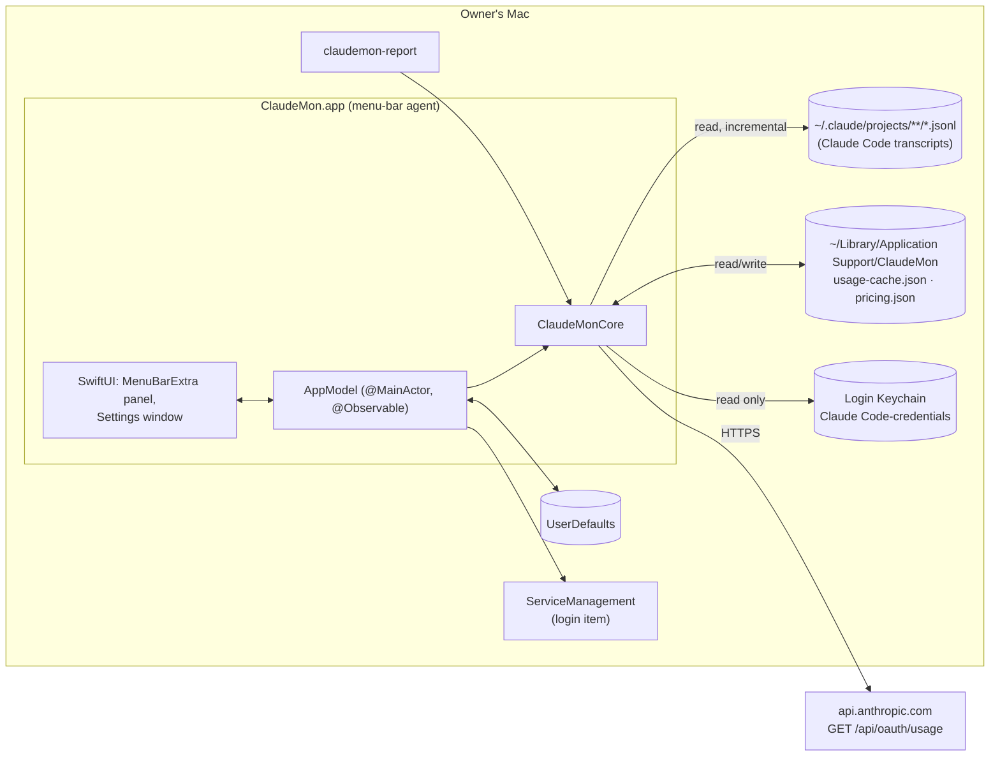

# ARCH — Architecture

## System overview

| Component | Process | Data stores | External |
|---|---|---|---|
| `ClaudeMonCore` (library) | in-process | `usage-cache.json`, `pricing.json` | Keychain (read), `api.anthropic.com` |
| `ClaudeMon` (app) | menu-bar agent, one process | `UserDefaults` | ServiceManagement |
| `claudemon-report` (CLI) | short-lived | the app's `usage-cache.json`, or a temporary one | — |

The app's state flows one way: `TranscriptStore` and `PlanUsageClient` feed `AppModel`, which holds the entries and plan status; views compute reports from it on demand through `ReportBuilder`. There is no database and no background daemon.

## Pages

<!-- generated:children -->
| ID | Title | Status |
|---|---|---|
| ARCH.1 | [Transcript accounting (core)](core-transcripts.md) | approved |
| ARCH.2 | [Plan-limit client](plan-limits.md) | approved |
| ARCH.3 | [Reports and pricing](reports-pricing.md) | approved |
| ARCH.4 | [App and UI](app-ui.md) | approved |
| ARCH.5 | [Terminal report](cli.md) | approved |
| ARCH.6 | [Data model](data-model.md) | approved |
| ARCH.7 | [Dependencies](dependencies.md) | approved |
<!-- /generated -->

## Revision history

| Version | Date | Change |
|---|---|---|
| 1.0.0 | 2026-10-15 | v1.0.0 (29d0828): initial page |
