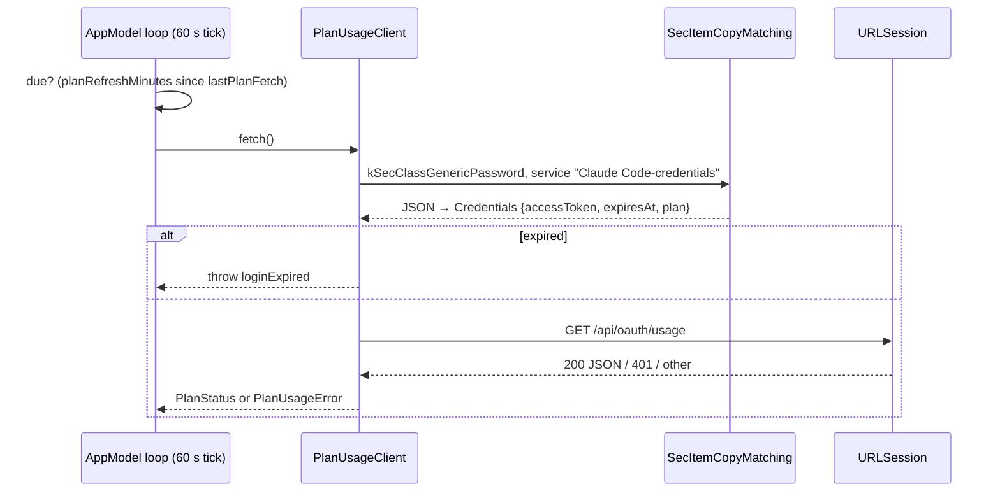

# ARCH.2 — Plan-limit client

Implements R-CMLIM-001 to R-CMLIM-008 (`spec/app/lim/`). Features through it: [F-1](../features/lim/f-001-plan-limits.md), [F-2](../features/lim/f-002-menu-bar-readout.md), [F-8](../features/cst/f-008-plan-vs-api.md) (plan price), [F-4](../features/use/f-004-usage-by-period.md) (plan week).

## Architecture Overview



The token is never written, refreshed or logged (DEC-3). macOS asks the owner once per build to allow the Keychain read ([BUILD.2](../build/packaging.md)).

## Key Symbols

| Symbol | File | Role |
|---|---|---|
| `PlanUsageClient` | `Sources/ClaudeMonCore/PlanUsage.swift` | `readCredentials()`, `fetch()`, `parse(_:plan:fetchedAt:)` |
| `PlanStatus` | same | Plan plus limits; `weeklyWindowStart` = weekly `resets_at` − 7 days |
| `PlanLimit` | same | id, title, group (`session` / `weekly`), percentUsed, resetsAt, severity |
| `Plan` | same | `displayName`, `listMonthlyPrice` from `rateLimitTier` / `subscriptionType` |
| `PlanUsageError` | same | `noCredentials`, `loginExpired`, `http`, `badResponse`, each with a message |

## API Reference

```swift
public enum PlanUsageClient {
    public static func fetch() async throws -> PlanStatus
    public static func parse(_ data: Data, plan: Plan, fetchedAt: Date) throws -> PlanStatus
}
```

Response mapping: `limits[].kind` `session` → "Session (5 h)", `weekly_all` → "Weekly · all models", `weekly_scoped` → "Weekly · <scope.model.display_name>". If `limits` is absent or empty, the client reads `five_hour`, `seven_day`, `seven_day_opus` and `seven_day_sonnet` (`utilization`, `resets_at`).

## Debugging

- **Tests:** `xcrun swift test --filter PlanUsageTests`.
- **"No Claude Code login found":** the Keychain access was denied, or Claude Code isn't logged in. To re-grant, rebuild or remove the app from the item's access list in Keychain Access.
- **"login has expired":** run `claude` once; Claude Code refreshes its own token.
- **Turn it off:** Settings › Fetch session and weekly limits. Token tracking is unaffected.

## Revision history

| Version | Date | Change |
|---|---|---|
| 1.0.0 | 2026-10-15 | v1.0.0 (29d0828): initial page |
