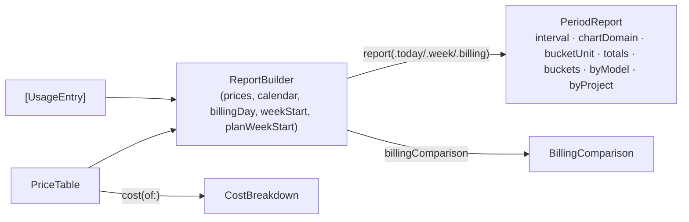

# ARCH.3 — Reports and pricing

Implements R-CMRPT-001 to R-CMRPT-008 and R-CMCST-001 to R-CMCST-011 (`spec/app/rpt/`, `spec/app/cst/`). Features through it: [F-4](../features/use/f-004-usage-by-period.md), [F-5](../features/use/f-005-usage-charts.md), [F-6](../features/use/f-006-breakdowns.md), [F-7](../features/cst/f-007-api-equivalent-cost.md), [F-8](../features/cst/f-008-plan-vs-api.md), [F-12](../features/app/f-012-terminal-report.md).

## Architecture Overview



`ReportBuilder` is a value type, rebuilt by `AppModel.builder` whenever a setting changes. Reports are computed on demand at each render, from about 12,000 entries. That is fast enough that nothing is cached.

## Key Symbols

| Symbol | File | Role |
|---|---|---|
| `ReportBuilder` | `Sources/ClaudeMonCore/Reports.swift` | Intervals, reports, billing comparison, `family(of:)` |
| `PeriodReport`, `TokenTotals`, `UsageBucket`, `BreakdownRow` | same | Report values |
| `BillingComparison` | same | Cost to date, projection, savings, value multiple |
| `PriceTable`, `ModelPrice`, `CostBreakdown` | `Sources/ClaudeMonCore/Pricing.swift` | Prices (`standard` defaults, `loadOrInstall(at:)`), `cost(of:)` |

## API Reference

```swift
public struct ReportBuilder: Sendable {
    public init(prices: PriceTable, calendar: Calendar = .current, billingDay: Int = 1,
                weekStart: WeekStart = .planReset, planWeekStart: Date? = nil)
    public func interval(for period: ReportPeriod, now: Date) -> DateInterval
    public func billingInterval(now: Date) -> DateInterval
    public func report(_ period: ReportPeriod, entries: [UsageEntry], now: Date) -> PeriodReport
    public func billingComparison(entries: [UsageEntry], now: Date, planPrice: Double?) -> BillingComparison
    public static func family(of model: String) -> String
}
public struct PriceTable: Codable, Sendable {
    public static let standard: PriceTable
    public func price(for model: String) -> ModelPrice?          // longest id prefix
    public func cost(of e: UsageEntry) -> CostBreakdown?        // nil = unpriced
    public static func loadOrInstall(at url: URL) -> PriceTable // FMT.1
}
```

## Debugging

- **Tests:** `xcrun swift test --filter "PricingTests|ReportTests"`.
- **A model shows as "Unpriced":** add its id (or a prefix) to `pricing.json`, then use Settings › Reload prices.
- **A malformed `pricing.json`** silently falls back to the built-in defaults; the file is left alone. Validate it with `python3 -m json.tool`.
- **Week totals look off:** check Settings › Week starts. With "Plan's weekly reset" the week ends at the plan's reset time, not midnight.

## Revision history

| Version | Date | Change |
|---|---|---|
| 1.0.0 | 2026-10-15 | v1.0.0 (29d0828): initial page |
