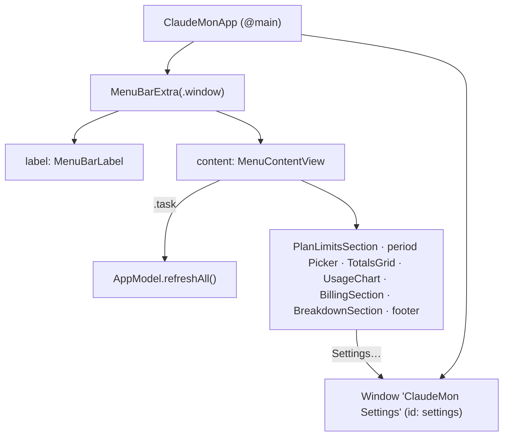

# F-9 — Menu bar app

## F-9 — Menu bar app (base)

### What

It implements the following at spec 1.0.0:

- R-CMUI-001, menu bar only;
- R-CMUI-003, panel contents and order;
- R-CMUI-004, panel width;
- R-CMUI-009, refresh on open.

They serve F-9.AC-1 (menu bar only, no Dock icon) and F-9.AC-2 (a panel with limits and usage, with Settings and Quit reachable from it).

### How



### Where

| Requirement | File | Symbols |
|---|---|---|
| R-CMUI-001 | `Resources/Info.plist` | LSUIElement |
| R-CMUI-001 | `Sources/ClaudeMon/ClaudeMonApp.swift` | ClaudeMonApp, MenuBarExtra |
| R-CMUI-003 | `Sources/ClaudeMon/MenuContentView.swift` | MenuContentView, PlanLimitsSection, TotalsGrid, BillingSection, BreakdownSection |
| R-CMUI-004 | `Sources/ClaudeMon/MenuContentView.swift` | MenuContentView |
| R-CMUI-009 | `Sources/ClaudeMon/AppModel.swift` | AppModel.refreshAll() |

### Why

- **"Registered in the task bar" (SRC-1) is the macOS menu bar (DEC-1).** An agent with no Dock icon (`LSUIElement`) is the native form.
- **`MenuBarExtra` in `.window` style** rather than a menu, because the content is charts and grids, not menu items.

### How to test

R-CMUI-001, -003, -004 and -009 cases are `ui` and not yet executed as recorded verification items. Observed in use and in screenshots `scr-app-1-*.png` (definition design).

### Limits

- The panel is about 900 pt tall on the Billing month tab with three limits shown. On a 13" display it can run close to the bottom of the screen.

## COR-1 — Panel stays anchored under the menu bar

### What

R-CMUI-008 (added by correction COR-1 at spec 1.1.0): the panel stays top-anchored under the menu bar and matches its content's height after any content change. It restores F-9.AC-2 after the bug in SRC-2.

### How

```mermaid
sequenceDiagram
    participant V as MenuContentView
    participant F as WindowFitter (ViewModifier)
    participant R as WindowReader (NSViewRepresentable)
    participant W as NSWindow (MenuBarExtra panel)
    R->>F: window = view.window
    V->>F: onGeometryChange(height)
    F->>W: resize(to: height): frame.height = content height, origin.y = old maxY − height
    Note over W: top edge stays under the menu bar; window shrinks as well as grows
```

### Where

| Requirement | File | Symbols |
|---|---|---|
| R-CMUI-008 | `Sources/ClaudeMon/WindowFitter.swift` | WindowFitter, WindowReader, fitsMenuBarWindow(), resize(to:) |
| R-CMUI-008 | `Sources/ClaudeMon/MenuContentView.swift` | fitsMenuBarWindow |

### Why

- **Root cause.** A `.window`-style `MenuBarExtra` grows its window when content grows but never shrinks it. The shorter Today content was centred in the 895 pt window left over from Billing month, so the panel appeared to drop away from the menu bar.
- **The fix keeps the top edge** (`frame.maxY`), not the origin, because AppKit frames grow from the bottom-left. The content is also top-aligned, so a frame that hasn't been resized yet never centres it.
- **Spec gap.** No requirement covered anchoring, so COR-1 is both a code fix and a spec addition.

### How to test

| Case | Level | How |
|---|---|---|
| R-CMUI-008.T1 | ui | Executed 2026-10-15 with scripted System Events (click the status item, click the radio buttons, read `position`/`size` of window 1). After the fix: height 567 → 699 → 567 pt across Today → Billing month → Today, top fixed at y = 35. Before it: height stuck at 895 pt. |

There is no automated regression test. UI tests for `MenuBarExtra` need an app host the package doesn't have ([DEV](../../deviations/index.md) D-9).

### Limits

- It relies on reaching the `NSWindow` behind `MenuBarExtra`, an implementation detail of SwiftUI on macOS 14–27.

## Revision history

| Version | Date | Change |
|---|---|---|
| 1.1.0 | 2026-10-15 | v1.0.1 (4a42147): COR-1 section |
| 1.0.0 | 2026-10-15 | v1.0.0 (29d0828): base section |
