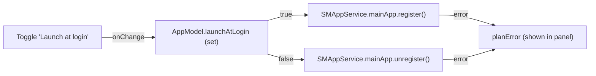

# F-11 — Launch at login

## F-11 — Launch at login (base)

### What

R-CMUI-007 (a login item through `SMAppService`) at spec 1.0.0. It serves F-11.AC-1, an opt-in toggle.

### How

### Where

| Requirement | File | Symbols |
|---|---|---|
| R-CMUI-007 | `Sources/ClaudeMon/AppModel.swift` | AppModel.launchAtLogin, SMAppService |
| R-CMUI-007 | `Sources/ClaudeMon/SettingsView.swift` | SettingsView |

### Why

- `SMAppService.mainApp` is the system's own login-item API (macOS 13+). No helper app and no LaunchAgent plist are needed.

### How to test

R-CMUI-007 cases are `manual` and **not executed**: the toggle has never been recorded as turned on ([DEV](../../deviations/index.md) P-3).

### Limits

- Registration errors are shown through the plan-error line, which is shared with plan-limit errors.
- An ad-hoc signed app in `~/Applications` may need approval in System Settings › General › Login Items.

## Revision history

| Version | Date | Change |
|---|---|---|
| 1.0.0 | 2026-10-15 | v1.0.0 (29d0828): base section |
