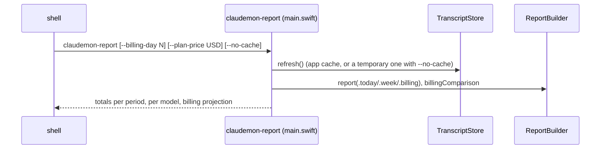

# F-12 — Terminal report

## F-12 — Terminal report (base)

### What

R-CMCLI-001 to R-CMCLI-003 at spec 1.0.0. They serve F-12.AC-1: one command prints the today, week and month totals and costs from the same calculations as the app.

### How

### Where

| Requirement | File | Symbols |
|---|---|---|
| R-CMCLI-001 | `Sources/claudemon-report/main.swift` | --billing-day, --plan-price, --no-cache |
| R-CMCLI-002 | `Sources/claudemon-report/main.swift` | ReportBuilder, TranscriptStore, PriceTable.loadOrInstall |
| R-CMCLI-003 | `Sources/claudemon-report/main.swift` | useCache, removeItem |

### Why

- **It exists to cross-check the app.** Its numbers were compared with an independent Python recount before release (R-CMRPT-005.T1).
- **It uses the same `ClaudeMonCore`,** so there is one implementation of every calculation.
- **The week is always the calendar week (Monday)** because the CLI doesn't fetch plan limits.

### How to test

| Case | Level | How |
|---|---|---|
| R-CMRPT-005.T1 | measurement | Executed 2026-10-15 with `claudemon-report --no-cache --plan-price 100` (see [F-4](../use/f-004-usage-by-period.md)) |
| R-CMCLI-001 to -003 | manual | Specified, not yet executed as recorded verification items |

### Limits

- The output is human-readable only; there is no JSON or CSV.
- Unknown arguments print the usage and exit 2.

## Revision history

| Version | Date | Change |
|---|---|---|
| 1.0.0 | 2026-10-15 | v1.0.0 (29d0828): base section |
