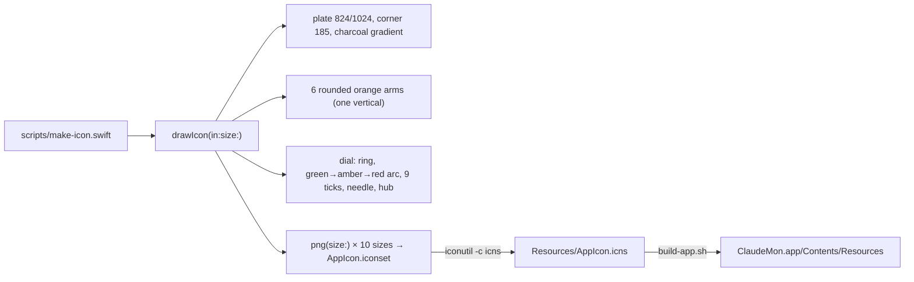

# F-13 — App icon

## F-13 — App icon (base)

### What

R-CMUI-011 (icon content) and R-CMUI-012 (macOS icon grid, generated in code) at spec 1.2.0, plus R-CMUI-013 at its first revision (speedometer radius 178). They serve F-13.AC-1 (an orange asterisk with a speedometer overlaid), F-13.AC-2 (the original speedometer size) and F-13.AC-3 (shown full size by the system).

### How

### Where

| Requirement | File | Symbols |
|---|---|---|
| R-CMUI-011 | `scripts/make-icon.swift` | drawIcon(in:size:), color(_:_:) |
| R-CMUI-012 | `scripts/make-icon.swift` | drawIcon(in:size:), png(size:), iconutil |
| R-CMUI-012 | `Resources/Info.plist` | CFBundleIconFile |
| R-CMUI-012 | `scripts/build-app.sh` | AppIcon.icns |

### Why

- **Drawn in code with Core Graphics** rather than in an image editor: it can be regenerated and reviewed, and it needs no third-party assets or tools (DEC-4).
- **The first version** had eight short arms and a large dial, and read as a ship's wheel. It was changed before release to six longer arms with one vertical, like a typed `*`, and a smaller dial (radius 178).
- **The standard macOS grid** (an 824 pt plate inset 100 pt on a 1024 canvas) means macOS 26 shows the icon full size, not shrunk onto a grey plate.

### How to test

| Case | Level | How |
|---|---|---|
| R-CMUI-012.T1 | ui | Executed 2026-10-15: `NSWorkspace.shared.icon(forFile:)` on the installed app rendered the icon full size |
| R-CMUI-011 | manual | Owner review of the rendered icon. Accepted implicitly: the owner only asked for a revision (SRC-5). |

### Limits

- `.icns` only. There is no Icon Composer (`.icon`) layer set, so the macOS 26 tinted and clear styles are system-derived.

## F-13.CR-1 — Larger speedometer

### What

R-CMUI-013 at revision 2 (spec 1.3.0): speedometer radius 231/1024 (178 × 1.3). It serves F-13.AC-4 and supersedes F-13.AC-2.

### How

One constant changes: `let r: CGFloat = 231 // 178 × 1.3`. Every dial detail is laid out relative to `r` through `k = r / 225`, so the ring, arc, ticks, needle and hub all scale with it. The icon is regenerated with `xcrun swift scripts/make-icon.swift`.

### Where

| Requirement | File | Symbols |
|---|---|---|
| R-CMUI-013 | `scripts/make-icon.swift` | drawIcon(in:size:) |

### Why

- The owner asked for it: "increase spedometer size by 30%" (SRC-5).
- **Scaling through `k`** keeps the dial's proportions, so a size change is one number.

### How to test

| Case | Level | How |
|---|---|---|
| R-CMUI-013 | manual | Owner review. Accepted: "Looks good." (SRC-6). Rendered preview checked during the build. |

### Limits

- At radius 231 the dial covers the inner half of the arms. At 16 pt the asterisk reads mainly as orange tips.

## Revision history

| Version | Date | Change |
|---|---|---|
| 1.3.0 | 2026-10-15 | v1.2.0 (736d417): F-13.CR-1 section |
| 1.2.0 | 2026-10-15 | v1.1.0 (1618231): base section |
