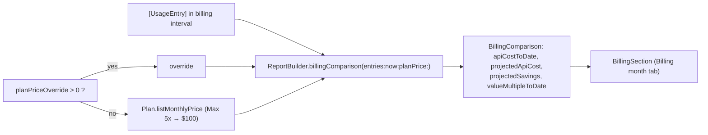

# F-8 — Plan vs API billing

## F-8 — Plan vs API billing (base)

### What

R-CMCST-008 to R-CMCST-011 at spec 1.0.0, plus R-CMLIM-008 for the plan's list price. They serve:

- F-8.AC-1: API cost so far this billing month;
- F-8.AC-2: a projection for the whole month;
- F-8.AC-3: the plan price, detected and overridable;
- F-8.AC-4: which is cheaper, and by how much.

### How

### Where

| Requirement | File | Symbols |
|---|---|---|
| R-CMCST-008 | `Sources/ClaudeMonCore/Reports.swift` | ReportBuilder.billingComparison(entries:now:planPrice:), BillingComparison.apiCostToDate |
| R-CMCST-009 | `Sources/ClaudeMonCore/Reports.swift` | BillingComparison.projectedApiCost, BillingComparison.elapsedFraction |
| R-CMCST-010 | `Sources/ClaudeMon/AppModel.swift` | AppModel.effectivePlanPrice, planPriceOverride |
| R-CMCST-011 | `Sources/ClaudeMonCore/Reports.swift` | BillingComparison.projectedSavings, BillingComparison.valueMultipleToDate |
| R-CMCST-011 | `Sources/ClaudeMon/MenuContentView.swift` | BillingSection |

### Why

- **Linear projection, held until 1/30 of the period has elapsed.** Projecting from the first hours of a month gives wild numbers. The projection is never below the cost to date.
- **Plan price from the stored login's `rateLimitTier`.** The owner shouldn't have to type what the login already knows. An override exists for discounts and other plans.
- On 2026-10-15 (48% of the period elapsed) the panel showed $343 so far and $713 projected, against $100 for Max 5x: "Plan saves ~$613".

### How to test

| Case | Level | How |
|---|---|---|
| R-CMCST-009.T1 | unit | `ReportTests.billingProjectionScalesByElapsedTime` |
| R-CMCST-011.T1 | unit | same test (savings −60) |
| R-CMLIM-008.T1 | unit | `PlanUsageTests.parsesLimitsArray` (Max 5x, $100) |
| R-CMCST-008, -010 | manual | Specified, not yet executed as recorded verification items |

### Limits

- Mid-period plan changes and pro-rated charges are not modelled.
- Usage that leaves no local transcript (chat, other devices) is not in the API figure, so the comparison understates the plan's value.

## Revision history

| Version | Date | Change |
|---|---|---|
| 1.0.0 | 2026-10-15 | v1.0.0 (29d0828): base section |
