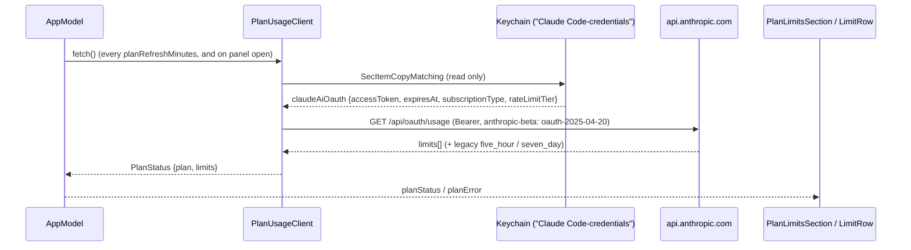

# F-1 — Plan limits at a glance

## F-1 — Plan limits at a glance (base)

### What

It implements the following at spec 1.0.0 (unchanged at 1.3.0):

- R-CMLIM-001 to R-CMLIM-008, reading plan limits;
- R-CMLIM-009 to R-CMLIM-011, presenting them.

They serve F-1.AC-1 to F-1.AC-5: session and weekly limits with % used, % left and reset time; periodic and on-demand refresh; status colour plus icon; errors shown while token tracking continues.

### How



### Where

| Requirement | File | Symbols |
|---|---|---|
| R-CMLIM-001 | `Sources/ClaudeMonCore/PlanUsage.swift` | PlanUsageClient.readCredentials(), keychainService |
| R-CMLIM-002 | `Sources/ClaudeMonCore/PlanUsage.swift` | PlanUsageClient.fetch() |
| R-CMLIM-003 | `Sources/ClaudeMonCore/PlanUsage.swift` | PlanUsageClient.endpoint, PlanUsageClient.fetch() |
| R-CMLIM-004 | `Sources/ClaudeMonCore/PlanUsage.swift` | PlanUsageClient.parse(_:plan:fetchedAt:), PlanUsageClient.title(kind:scope:), PlanLimit |
| R-CMLIM-005 | `Sources/ClaudeMonCore/PlanUsage.swift` | PlanUsageClient.parse(_:plan:fetchedAt:) |
| R-CMLIM-006 | `Sources/ClaudeMonCore/PlanUsage.swift` | PlanUsageError.loginExpired, PlanUsageError.errorDescription |
| R-CMLIM-007 | `Sources/ClaudeMon/AppModel.swift` | AppModel.start(), AppModel.refreshPlan(), planRefreshMinutes |
| R-CMLIM-008 | `Sources/ClaudeMonCore/PlanUsage.swift` | Plan.displayName, Plan.listMonthlyPrice |
| R-CMLIM-009 | `Sources/ClaudeMon/MenuContentView.swift` | LimitRow |
| R-CMLIM-009 | `Sources/ClaudeMon/Theme.swift` | Format.resetText(_:), Format.percent(_:) |
| R-CMLIM-010 | `Sources/ClaudeMon/Theme.swift` | Theme.status(forPercentUsed:), Theme.good, Theme.warning, Theme.critical |
| R-CMLIM-011 | `Sources/ClaudeMon/MenuContentView.swift` | PlanLimitsSection |

### Why

- **The usage endpoint, not local estimates (ADR-3).** Plan limits are computed server-side and include claude.ai chat and other devices, so no local count can reproduce them. Claude Code's own `/usage` reads `GET /api/oauth/usage`, and so does this feature. The endpoint is undocumented; that risk was accepted.
- **Read-only login (DEC-3, R-CMLIM-002).** OAuth refresh tokens rotate, so refreshing here would sign Claude Code out. An expired token produces a message, not a refresh.
- **Generic `limits` array first.** It already carried a scoped weekly limit ("Weekly · Fable") that the legacy fields lack. The legacy fields remain as a fallback.

### How to test

```sh
xcrun swift test --filter PlanUsageTests
```

| Case | Level | How |
|---|---|---|
| R-CMLIM-004.T1 | unit | `PlanUsageTests.parsesLimitsArray` |
| R-CMLIM-008.T1 | unit | `PlanUsageTests.parsesLimitsArray` (Max 5x, $100) |
| R-CMLIM-005.T1 | unit | `PlanUsageTests.fallsBackToLegacyFields` |
| R-CMLIM-003.T1 | integration | Executed once on 2026-10-15: a live call with the owner's Max 5x login returned 200 with `five_hour`, `seven_day` and `limits` |
| R-CMLIM-001, -002, -006, -007, -009 to -011 | manual / ui | Specified, not yet executed as recorded verification items |

### Limits

- The endpoint and the Keychain item format are private to Claude Code and Anthropic and may change without notice.
- The "Loading plan limits…" state lasts until the first fetch, which needs the Keychain grant.

## Revision history

| Version | Date | Change |
|---|---|---|
| 1.0.0 | 2026-10-15 | v1.0.0 (29d0828): base section |
