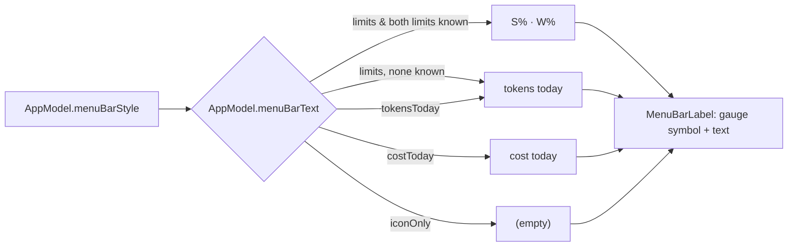

# F-2 — Menu bar readout

## F-2 — Menu bar readout (base)

### What

R-CMUI-002, the menu-bar label (gauge symbol plus text by style), at spec 1.0.0. It serves F-2.AC-1 (session % · weekly %), F-2.AC-2 (style: limits, tokens today, cost today, icon only) and F-2.AC-3 (falls back to tokens today when no limits are available).

### How

### Where

| Requirement | File | Symbols |
|---|---|---|
| R-CMUI-002 | `Sources/ClaudeMon/ClaudeMonApp.swift` | MenuBarLabel |
| R-CMUI-002 | `Sources/ClaudeMon/AppModel.swift` | AppModel.menuBarText, MenuBarStyle, sessionLimit, weeklyLimit |

### Why

- Session and weekly percentages are the two numbers that answer "can I start a long session now?" without opening anything (SRC-1: "without needing to prompt for usage in the CLI session").
- The text uses monospaced digits, so the menu bar doesn't jitter as numbers change.

### How to test

R-CMUI-002 cases are `ui` / `manual` and not yet executed as recorded verification items. Observed in use: the screenshot `scr-app-3-menubar.png` in the definition shows `39% · 7%`.

### Limits

- `iconOnly` still shows the gauge symbol, because the label cannot be empty.

## Revision history

| Version | Date | Change |
|---|---|---|
| 1.0.0 | 2026-10-15 | v1.0.0 (29d0828): base section |
