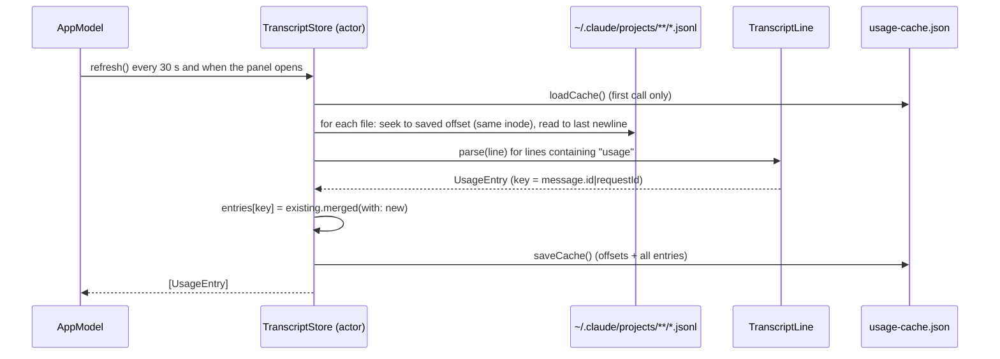

# F-3 — Claude Code token accounting

## F-3 — Claude Code token accounting (base)

### What

It implements the following at spec 1.0.0:

- R-CMUSE-001 to R-CMUSE-006, reading transcripts and counting each call once;
- R-CMUSE-007 to R-CMUSE-010, keeping history.

They serve F-3.AC-1 (every billed call, four token categories), F-3.AC-2 (counted once, final counts), F-3.AC-3 (history survives transcript deletion) and F-3.AC-4 (new usage within a minute).

### How



### Where

| Requirement | File | Symbols |
|---|---|---|
| R-CMUSE-001 | `Sources/ClaudeMonCore/TranscriptStore.swift` | TranscriptStore.defaultRoots(), transcriptFiles() |
| R-CMUSE-002 | `Sources/ClaudeMonCore/UsageEntry.swift` | TranscriptLine.parse(_:fallbackProject:) |
| R-CMUSE-003 | `Sources/ClaudeMonCore/TranscriptStore.swift` | TranscriptStore.scan(_:), FileState |
| R-CMUSE-004 | `Sources/ClaudeMonCore/UsageEntry.swift` | UsageEntry.merged(with:) |
| R-CMUSE-004 | `Sources/ClaudeMonCore/TranscriptStore.swift` | TranscriptStore.scan(_:) |
| R-CMUSE-005 | `Sources/ClaudeMonCore/UsageEntry.swift` | TranscriptLine.parse(_:fallbackProject:), UsageEntry.cacheWrite5mTokens, UsageEntry.cacheWrite1hTokens |
| R-CMUSE-006 | `Sources/ClaudeMonCore/UsageEntry.swift` | TranscriptLine.parse(_:fallbackProject:), UsageEntry.project |
| R-CMUSE-007 | `Sources/ClaudeMonCore/TranscriptStore.swift` | TranscriptStore.saveCache(), TranscriptStore.loadCache(), Cache |
| R-CMUSE-008 | `Sources/ClaudeMonCore/TranscriptStore.swift` | TranscriptStore.loadCache() |
| R-CMUSE-009 | `Sources/ClaudeMonCore/TranscriptStore.swift` | TranscriptStore.rescanAll() |
| R-CMUSE-010 | `Sources/ClaudeMon/AppModel.swift` | AppModel.start(), AppModel.refreshTranscripts(full:) |
| R-CMUSE-010 | `Sources/ClaudeMon/MenuContentView.swift` | MenuContentView |

### Why

- **Transcripts as the source (ADR-2).** They are the only local record of per-call usage. `usage` carries input, output, the 5-minute and 1-hour cache writes, and cache reads.
- **Max merge, not first line wins (R-CMUSE-004).** Claude Code writes one response several times. In the owner's data, 1,274 of 13,272 duplicate lines carried different counts, with later lines larger (output 3 → 196). Keeping the first line would undercount output.
- **Byte-offset incremental reads.** The transcripts total 529 MB across 203 files. Re-reading only appended bytes keeps a refresh under a millisecond once warm. The inode check catches files that were rewritten. A trailing partial line is left for the next read.
- **Own cache (ADR-4, R-CMUSE-008).** Claude Code deletes transcripts after about 30 days, which would leave a billing month incomplete.

### How to test

```sh
xcrun swift test --filter "ParsingTests|StoreTests"
```

| Case | Level | How |
|---|---|---|
| R-CMUSE-002.T1 | unit | `ParsingTests.parsesUsageLine` |
| R-CMUSE-002.T2 | unit | `ParsingTests.ignoresNonUsageAndSyntheticLines` |
| R-CMUSE-006.T1 | unit | `ParsingTests.parsesUsageLine` (project `MyProj`) |
| R-CMUSE-005.T1 | unit | `ParsingTests.missingTTLBreakdownCountsAsFiveMinute` |
| R-CMUSE-004.T1 | unit | `ParsingTests.duplicatesMergeWithMaxPerField` |
| R-CMUSE-003.T1 | integration | `StoreTests.incrementalScanHandlesPartialLinesAndDuplicates` |
| R-CMUSE-008.T1 | integration | same test: a fresh store restores both entries after the transcript is deleted |
| R-CMUSE-003.T2 | measurement | Executed 2026-10-15: cold scan of 529 MB / 203 files in 3.9 s (release build) |
| R-CMUSE-001, -007, -009, -010 | manual | Specified, not yet executed as recorded verification items |

### Limits

- Only Claude Code usage on this Mac is counted. claude.ai chat, Cowork and other devices leave no local transcript (they still count toward plan limits, F-1).
- The cache grows without bound (about 12,000 entries ≈ 3 MB so far). There is no pruning yet.

## Revision history

| Version | Date | Change |
|---|---|---|
| 1.0.0 | 2026-10-15 | v1.0.0 (29d0828): base section |
