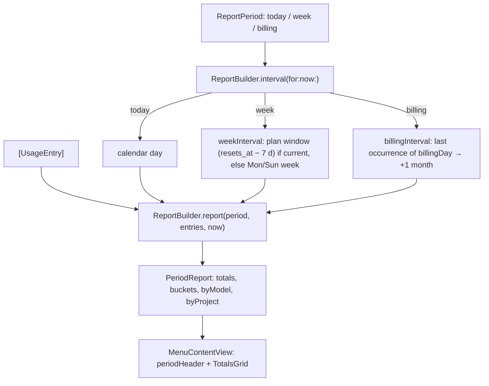

# F-4 — Usage by period

## F-4 — Usage by period (base)

### What

It implements the following at spec 1.0.0:

- R-CMRPT-001 to R-CMRPT-004, periods;
- R-CMRPT-005, totals.

They serve F-4.AC-1 (today, week and billing month with totals, breakdown and requests), F-4.AC-2 (the week follows the plan's weekly reset by default, or starts Monday or Sunday) and F-4.AC-3 (a chosen billing day).

### How



### Where

| Requirement | File | Symbols |
|---|---|---|
| R-CMRPT-001 | `Sources/ClaudeMonCore/Reports.swift` | ReportBuilder.interval(for:now:) |
| R-CMRPT-002 | `Sources/ClaudeMonCore/Reports.swift` | ReportBuilder.weekInterval(now:), WeekStart |
| R-CMRPT-002 | `Sources/ClaudeMonCore/PlanUsage.swift` | PlanStatus.weeklyWindowStart |
| R-CMRPT-003 | `Sources/ClaudeMonCore/Reports.swift` | ReportBuilder.billingInterval(now:), billingDay |
| R-CMRPT-004 | `Sources/ClaudeMonCore/Reports.swift` | ReportBuilder.report(_:entries:now:) |
| R-CMRPT-005 | `Sources/ClaudeMonCore/Reports.swift` | TokenTotals, TokenTotals.add(_:cost:) |
| R-CMRPT-005 | `Sources/ClaudeMon/MenuContentView.swift` | TotalsGrid, MenuContentView.periodHeader(_:) |

### Why

- **The plan week by default.** The weekly limit resets at a fixed moment (here Monday 23:59 local). Token totals for the same window answer "what used up my weekly limit?". A calendar week wouldn't match.
- **A stale plan window falls back** to the calendar week. This happens when the last fetch is more than 7 days old or limits are off.
- **The billing day is clamped to 1–28**, so every month has it.

### How to test

```sh
xcrun swift test --filter ReportTests
```

| Case | Level | How |
|---|---|---|
| R-CMRPT-002.T1 | unit | `ReportTests.weekFollowsPlanResetWhenKnown` (plan window) |
| R-CMRPT-002.T2 | unit | same test (stale window → calendar week) |
| R-CMRPT-003.T1 | unit | `ReportTests.billingIntervalBeforeAndAfterBillingDay` |
| R-CMRPT-004.T1 | unit | `ReportTests.reportTotalsOnlyIncludeThePeriod` |
| R-CMRPT-005.T1 | measurement | Executed 2026-10-15. `claudemon-report --no-cache` gave 3,378 calls / $339.40 for the month; an independent Python recount gave 3,381 / $339.54. The difference is the calls made between the two runs. |
| R-CMRPT-001 | manual | Specified, not yet executed as a recorded verification item |

### Limits

- Time zones follow the Mac's current calendar. Usage near midnight moves between days if the zone changes.

## Revision history

| Version | Date | Change |
|---|---|---|
| 1.0.0 | 2026-10-15 | v1.0.0 (29d0828): base section |
