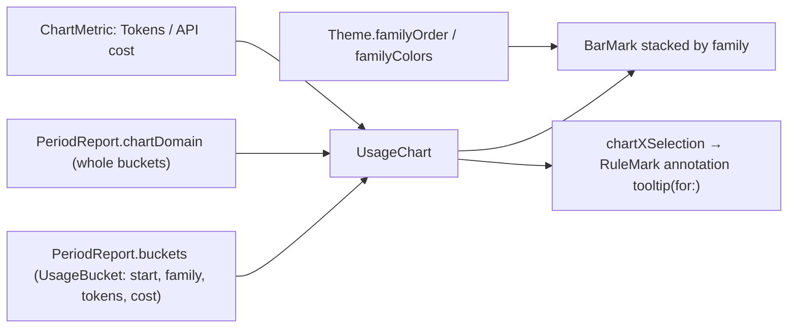

# F-5 — Usage charts

## F-5 — Usage charts (base)

### What

R-CMRPT-008 to R-CMRPT-011 at spec 1.0.0. They serve:

- F-5.AC-1: per-hour bars today, per-day bars otherwise, stacked by model family;
- F-5.AC-2: a tokens / API cost toggle;
- F-5.AC-3: a hover breakdown;
- F-5.AC-4: a fixed colour per family.

### How

### Where

| Requirement | File | Symbols |
|---|---|---|
| R-CMRPT-008 | `Sources/ClaudeMonCore/Reports.swift` | PeriodReport.chartDomain, PeriodReport.bucketUnit, UsageBucket |
| R-CMRPT-009 | `Sources/ClaudeMon/UsageChart.swift` | UsageChart, chartForegroundStyleScale |
| R-CMRPT-009 | `Sources/ClaudeMon/Theme.swift` | Theme.familyOrder, Theme.familyColors, Theme.color(forFamily:) |
| R-CMRPT-010 | `Sources/ClaudeMon/UsageChart.swift` | ChartMetric |
| R-CMRPT-011 | `Sources/ClaudeMon/UsageChart.swift` | UsageChart.tooltip(for:), chartXSelection |

### Why

- **The palette** is the validated data-viz reference palette, stepped separately for light and dark. Each family takes a fixed slot in a fixed order (Opus blue, Sonnet orange, Haiku aqua, Fable yellow, Mythos magenta, Other violet), so a colour always means the same family. Only families present appear in the legend.
- **Calendar-day bars in the plan week.** An earlier build aligned the bars to the reset time (Monday 23:59), and they didn't line up with the day labels. Totals still use the exact plan window; only the bars snap to days (`chartDomain` widens the interval to whole buckets).
- **One axis.** Tokens and cost are a toggle, never two scales.

### How to test

R-CMRPT-008 to R-CMRPT-011 cases are `ui` and not yet executed as recorded verification items. During the build, layout was checked with `ClaudeMon --snapshot <dir>` renders (`Snapshot.run(to:)`), in light and dark.

### Limits

- The hover tooltip needs a pointer; there is no keyboard access to individual bars.
- Cache reads dominate token totals (about 97%), so the "Tokens" chart mostly shows cache-read volume.

## Revision history

| Version | Date | Change |
|---|---|---|
| 1.0.0 | 2026-10-15 | v1.0.0 (29d0828): base section |
