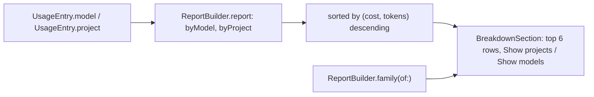

# F-6 — Breakdown by model and project

## F-6 — Breakdown by model and project (base)

### What

R-CMRPT-006 (breakdown by model and by project, sorted by cost) and R-CMRPT-007 (model family mapping) at spec 1.0.0. They serve F-6.AC-1 (the top models with tokens and cost) and F-6.AC-2 (a switch to projects).

### How

### Where

| Requirement | File | Symbols |
|---|---|---|
| R-CMRPT-006 | `Sources/ClaudeMonCore/Reports.swift` | PeriodReport.byModel, PeriodReport.byProject, BreakdownRow |
| R-CMRPT-006 | `Sources/ClaudeMon/MenuContentView.swift` | BreakdownSection |
| R-CMRPT-007 | `Sources/ClaudeMonCore/Reports.swift` | ReportBuilder.family(of:) |

### Why

- **Projects come from the transcript's `cwd`** (its last path component), not from the transcript's folder name. The folder name is an encoded path that is hard to read.
- **Six rows** keep the panel height bounded.

### How to test

| Case | Level | How |
|---|---|---|
| R-CMRPT-007.T1 | unit | `ReportTests.reportTotalsOnlyIncludeThePeriod` (families Opus, Sonnet, Other) |
| R-CMRPT-006 | ui | Specified, not yet executed as a recorded verification item |

### Limits

- Only the top six rows are shown, with no "more" link.
- Two projects in different folders with the same name merge into one row.

## Revision history

| Version | Date | Change |
|---|---|---|
| 1.0.0 | 2026-10-15 | v1.0.0 (29d0828): base section |
