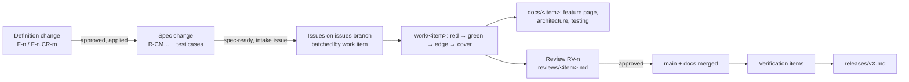

# WORK — Workflows

## How a change is meant to flow (SpecItOut rev 9)

1. **Intake.** The spec pins a definition version. The implementation pins a spec version (in `.specitout/sdd.json`, `specVersion`). An intake issue carries `Upstream. ClaudeMon-Definition@<spec version> · R-IDs`.
2. **Implement.** Per issue, the spec test cases are written and seen failing. Then come code, edge tests, `trace:` doc-comment annotations, and commits with `Spec-Ref`, `Work-Item` and `Issue` trailers.
3. **Document.** The work item's pages are written on `docs/<work-item>` beside the code: its feature-page section, the architecture pages it touches, and the test catalogue.
4. **Review and merge.** One review item per work item. On approval, `work/<item>` merges to `main` and `docs/<work-item>` merges to `docs`.
5. **Verify and release.** QA passes verification items, the PO passes acceptance items, and a release record is written here.

## How changes actually flowed for ClaudeMon

Every change happened in one conversation between the owner (`human:brian`) and the agent:

| Change | What happened | Evidence |
|---|---|---|
| v1.0.0 | The owner described the app (SRC-1). The agent researched the data sources, wrote the code and tests, cross-checked the numbers against an independent Python recount, and installed the app. | Commit `29d0828`; "App works well." (SRC-2) |
| COR-1 | The owner reported the panel drifting below the menu bar (SRC-2). The agent reproduced it with scripted System Events measurements, fixed it and re-measured. | Commit `4a42147` |
| F-13 | The owner asked for an icon (SRC-4). The agent drew it in code and checked it with the system's own icon rendering. | Commit `1618231` |
| F-13.CR-1 | The owner asked for a speedometer 30% larger (SRC-5), then accepted it: "Looks good." (SRC-6) | Commit `736d417` |

The definition, the specification and this site were all written afterwards. See [Deviations](../deviations/index.md) for each step that did not happen as the process describes.

## Revision history

| Version | Date | Change |
|---|---|---|
| 1.0.0 | 2026-10-15 | v1.0.0 (29d0828): initial page (written retroactively) |
